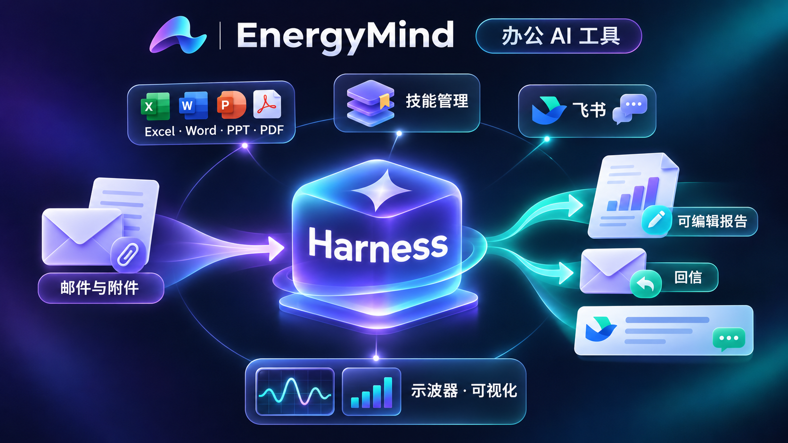
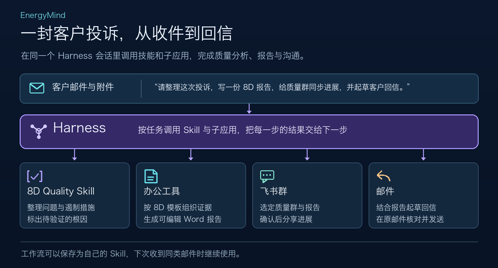
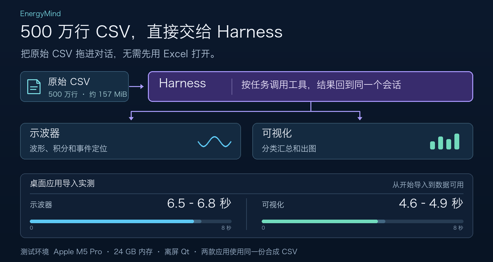

# EnergyMind

**EnergyMind 是一款办公 AI 工具，帮助你在同一个 Harness 会话里完成日常办公和专业任务。** 把邮件、飞书资料或办公文件交给 Harness，它会按任务调用技能和应用，生成可编辑的成果，并衔接后续沟通。

[下载 macOS 版](https://github.com/EugeneJian/EnergyMind-Releases/releases/latest) · [应用大厅](docs/application-hall.md) · [能力](#能力) · [500 万行实测](#500-万行-csv-直接交给-harness) · [使用指南](docs/user-guide.md) · [发行许可](https://github.com/EugeneJian/EnergyMind-Releases/blob/main/LICENSE)

5.2.17 Alpha · Apple 芯片 · macOS 14 及以上

## 从来信到报告和回信

收到客户投诉，在邮件里点「交给 Harness」，启用 8D 质量技能。Harness 根据正文和附件生成可编辑的 Word 报告，并在同一会话里起草飞书群的进展更新和客户回信。你核对报告中的证据和待验证事项，确认群消息后发布，回到原邮件核对并发送回复。 [按此场景试一次](docs/user-guide.md#从客户投诉到报告和回信)

## 能力

可以把飞书里的项目进度和 Excel 数据整理成汇报 PPT，也可以从邮件里的 PDF 通知提取待办并起草跟进邮件。

| 能力 | 在 EnergyMind 里怎么用 |
| --- | --- |
| **Excel、Word、PPT、PDF** | 汇总 Excel 表格、比较 Word 文档、提取 PDF 要点，并生成可编辑的 Excel、Word 和 PPT。扫描 PDF 可按页交给支持图片输入的模型。 |
| **邮箱** | 通过 IMAP/SMTP 连接邮箱，把正文和附件一键交给 Harness 整理、起草回复。邮件缓存使用 AES-256-GCM 在本机加密，邮箱凭据存入系统钥匙串。 [连接邮箱](docs/user-guide.md#连接邮箱) |
| **飞书 · Lark** | 安装并登录官方 `lark-cli` 后，Harness 可按账号授权使用已启用的飞书技能，处理文档、多维表格、消息、日历和任务等。从应用大厅打开「飞书」，可检查安装、配置和登录状态。 |
| **技能管理** | 用 Harness 把流程、脚本和模板做成 Skill，随时编辑、分组、启用或恢复旧版。签名 macOS 版的个人技能和分组可通过 iCloud 在同一 Apple 账户的多台 Mac 间同步。 |
| **专业工具** | 示波器支持波形测量、积分和事件定位。可视化可做分类汇总、筛选和出图。可单独使用，也可由 Harness 在同一任务中调用。 [大文件导入与性能](docs/user-guide.md#大文件导入与性能) |
| **Runtime** | 随版本跟进 Pi，5.2.17 内置 Pi 1.6.0。Harness 已定义会话、事件和工具接口，计划通过适配器接入更多 Runtime。 |

## 把团队的做法留成 Skill

在 Harness 里说「把刚才的投诉处理流程保存为技能」，核对报告模板和处理步骤，下次可以直接复用。团队发布的云端技能会自动单向下载到本机。 [技能管理与版本恢复](docs/user-guide.md#管理和同步技能)

## 工程分析

工程师可以从会话中的事件明细回到原始录波，用双游标复核功率变化，再打开 Word 文件继续编辑。 [查看示波器复核示例](docs/media/scope-cursors.png)

### 500 万行 CSV 直接交给 Harness

把原始 CSV 拖进对话，无需先用 Excel 打开。比如问「画出 8 点到 9 点的功率波形，再按天汇总发电量并出图」。Harness 可以调用示波器做测量，再用可视化把结果画成图。

[查看测试条件与 Excel 后台导入说明](docs/user-guide.md#大文件导入与性能)

## 个人数据与权限

对话、工作文件和生成结果默认保存在你的设备，录波和表格分析可离线完成。联网任务由本机直连对应服务，业务数据无需经 EnergyMind 服务器中转。使用在线模型时，本轮提问及任务所需的附件和工具结果会交给你选定的模型服务商。

Harness 默认在本机工作区执行任务。工作区外写入、管理员命令等受控操作触发工具检查时，Harness 会先请你确认。macOS「我的技能」通过同一 Apple 账户的专用 iCloud 容器同步，Apple 在传输和存储时加密。 [数据与安全](docs/user-guide.md#数据与安全) · [Apple 的 iCloud 数据安全说明](https://support.apple.com/en-us/102651)

[第三方组件与对应源码](THIRD-PARTY.md)
