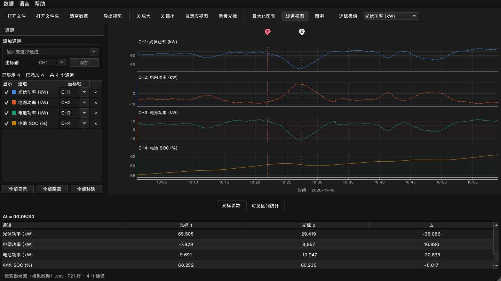
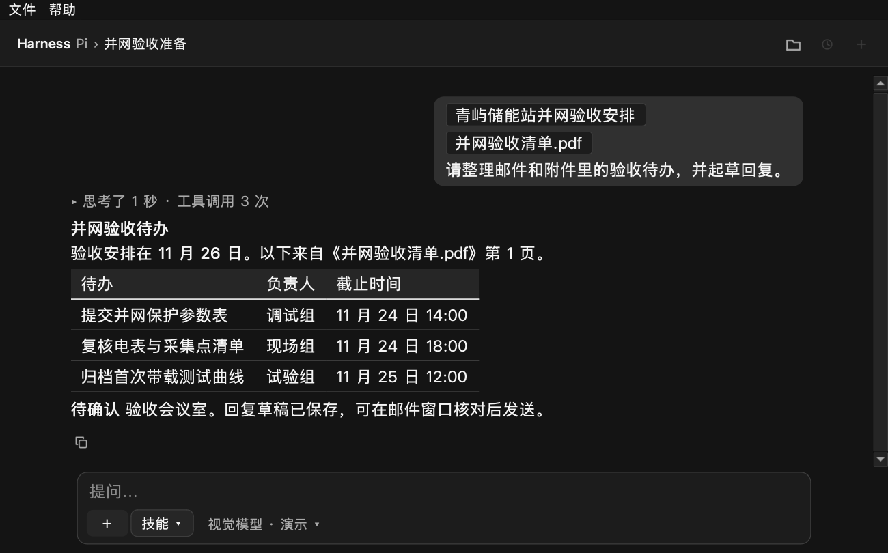

# EnergyMind

把设备录波交给 **Harness**，它选择 Skill，调用示波器做测量、用办公工具写复核单。事件明细、计算过程和可编辑文件都能在同一会话里打开。

**5.2.16 · Alpha · macOS 14 及以上 · Apple 芯片**

[下载 macOS 安装包](https://github.com/EugeneJian/EnergyMind-Releases/releases/latest) · [使用指南](docs/user-guide.md) · [发行许可](LICENSE)

## 光伏跌落期间，站点从电网取了多少电？

示例中，光伏功率低于 45 kW 且电网取电的状态持续了 **4 分 10 秒**。Harness 调用示波器对这段录波积分，得到电网取电 **0.446 kWh**、电池放电 **0.545 kWh**。点开事件 CSV 可以逐项核对，Word 复核单可继续编辑。

工程师可以回到同一份录波，把两个游标分别放在跌落前后，直接查看电网功率何时转为取电、电池何时开始放电。

## 一封带扫描件的验收邮件，需要谁在什么时候做什么？

在邮箱点「交给 Harness」。它读取正文和附件，把扫描 PDF 按页交给视觉模型，再把验收事项列成带出处的清单。回复草稿可回到邮箱核对、发送。

*截图来自真实应用界面，使用模拟数据和演示会话。*

本地录波分析支持离线使用。使用 Harness 需要自己的模型账号，提问、选用的附件及工具读取的内容可能发送给该模型服务商。发布包使用 Qt、PySide6 和 Shiboken6 的 LGPL 动态库。 [数据与安全](docs/user-guide.md#数据与安全) · [第三方许可及对应源码](THIRD-PARTY.md)
