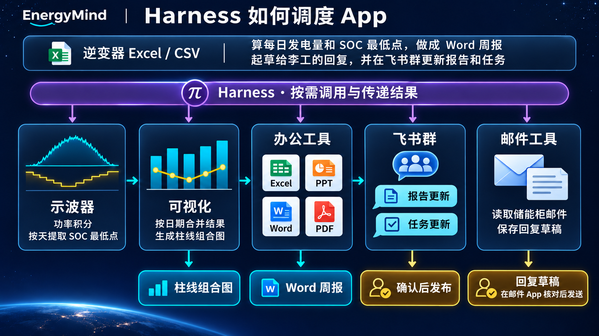

# EnergyMind

**把整件事交给 Harness。** 收到客户投诉，在邮件里点「交给 Harness」。它可以从附件里找证据，调用 8D 质量技能，生成可编辑的 Word 报告，再帮你同步到飞书群、起草客户回信。前一步的结果直接用于下一步，整件事留在同一个会话里。

[下载 macOS 版](https://github.com/EugeneJian/EnergyMind-Releases/releases/latest) · [使用指南](docs/user-guide.md) · [发行许可](https://github.com/EugeneJian/EnergyMind-Releases/blob/main/LICENSE)

5.2.16 Alpha · Apple 芯片 · macOS 14 及以上

试用这个场景时，先启用自己的 8D Skill，连接邮箱和飞书。报告里可以标出已确认的事实和仍待验证的根因。你审阅后确认发到哪个群，给客户的回信在原邮件中核对、发送。 [按此场景试一次](docs/user-guide.md#从客户投诉到报告和回信)

## 把团队的做法留成 Skill

在 Harness 里说「把刚才的流程保存为技能」，就能把报告模板和处理步骤留给下一次投诉。你可以在「技能」里新建、编辑和管理自己的 Skill，团队发布的云端技能会自动同步。签名 macOS 版的「我的技能」支持通过 iCloud 在自己的多台 Mac 间同步，也可预览旧版、恢复后继续编辑。 [技能管理与版本恢复](docs/user-guide.md#管理和同步技能)

## 同一个 Harness 也能完成工程任务

工程师可以从会话中的事件明细回到原始录波，用双游标复核功率变化，再打开 Word 文件继续编辑。 [查看示波器复核示例](docs/media/scope-cursors.png)

本地录波分析可离线使用。使用在线模型时，提问、选用的附件和任务需要的工具结果可能发送给该模型服务商。 [数据与安全](docs/user-guide.md#数据与安全) · [第三方组件与对应源码](https://github.com/EugeneJian/EnergyMind-Releases/blob/main/THIRD-PARTY.md)
