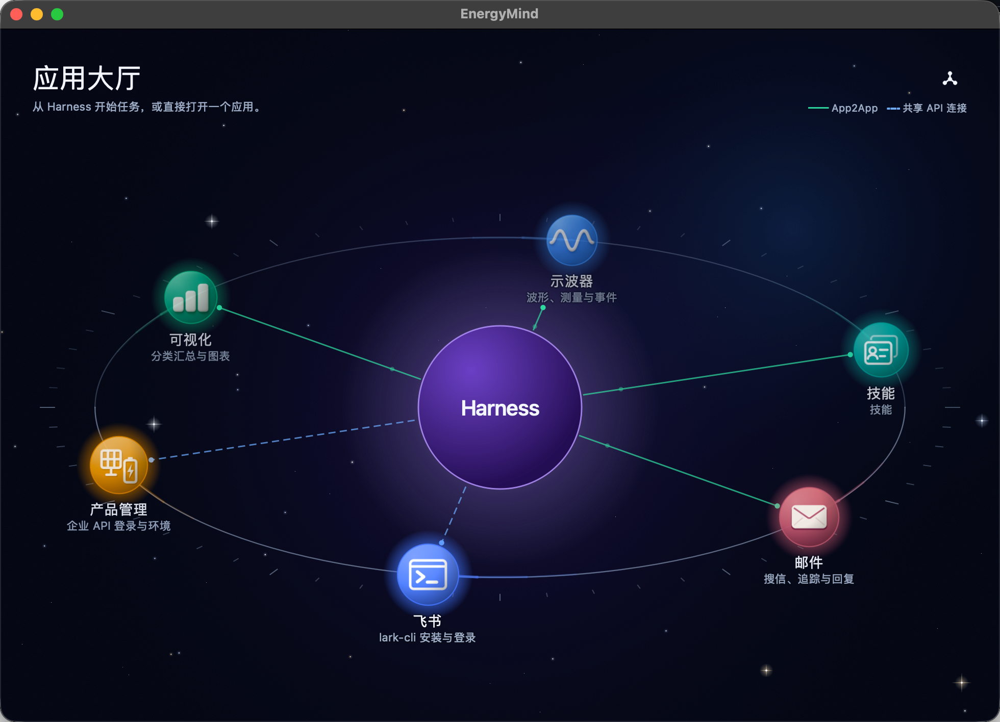

# 应用大厅

打开 EnergyMind 后，从中央的 **Harness** 交办一件事，或点击外围图标直接打开子应用。比如，给 Harness 一份录波，让它找出异常时段、画图并生成 Word 复核单。想查看某个时刻附近的波形，可以直接告诉 Harness 要看的时间，也可以打开「示波器」自行查看。

## 看懂两种连线

- **绿色实线 · App2App**　Harness 可以调用子应用开放的能力，即使对应窗口没有打开。例如调用示波器测量和积分、用可视化汇总表格、读取邮件并起草回复，或管理技能。结果和生成的文件会回到当前 Harness 会话。
- **蓝色虚线 · 共享 API 连接**　Harness 可以复用子应用管理的登录和授权。飞书沿用你自己的 `lark-cli` 登录，产品管理沿用员工登录与所选数据环境。实际能访问什么，由账号权限决定。

右上角的连线按钮用于显示或隐藏连线和图例。应用会记住这个选择。

## 各入口能做什么

| 入口 | 用途 |
| --- | --- |
| **Harness** | 交办跨应用任务，查看工具记录和结果。PDF、Word、Excel 和 PowerPoint 的内置办公工具也从这里调用。 |
| **示波器** | 打开设备录波，查看波形、用游标测量或查找事件。 |
| **可视化** | 导入表格，按分类汇总、筛选、下钻和出图。 |
| **技能** | 查看、启停技能，或创建、编辑和恢复自己的 Skill。 |
| **邮件** | 搜索和追踪来信，打开附件，或把邮件交给 Harness。回复草稿在邮件窗口核对后发送。 |
| **飞书** | 检查、安装或更新 `lark-cli`，登录并按任务补充授权。 |
| **产品管理** | 通过员工账号登录，选择产品数据环境，再按权限查询产品资料。 |

示波器和可视化均通过 500 万行数据测试，也可在后台导入 Excel。 [大文件导入与性能](user-guide.md#大文件导入与性能)

在子应用里选择 **「应用 → 返回大厅」**，即可重新选择入口。

[返回产品首页](../README.md) · [查看使用指南](user-guide.md)
