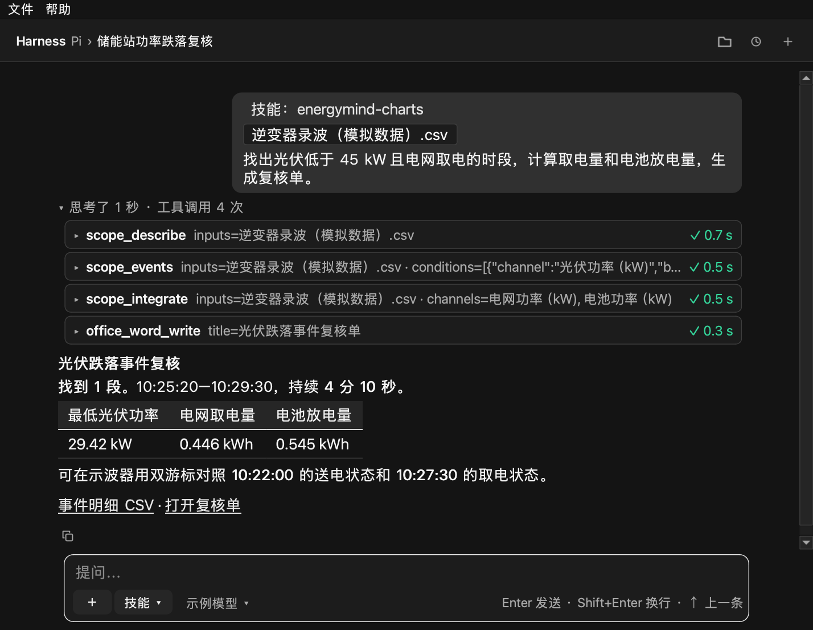
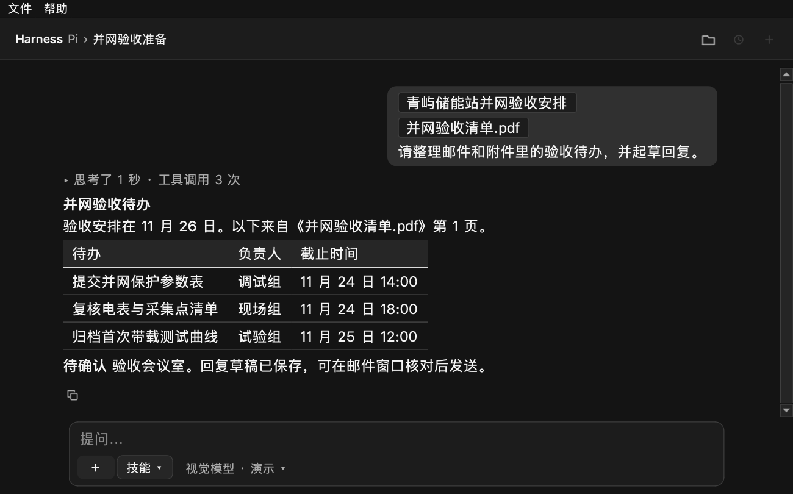

# EnergyMind 使用指南

[返回产品首页](../README.md)

## 安装与更新

1. 在「苹果菜单 → 关于本机」查看芯片和 macOS 版本。此包适用于 Apple 芯片和 macOS 14 或更高版本。
2. 从[官方发布页](https://github.com/EugeneJian/EnergyMind-Releases/releases/latest)下载以 `macOS-arm64.zip` 结尾的安装包和 `SHA256SUMS.txt`。普通安装只需要这两个文件。
3. 在终端进入下载目录，执行下面的命令。如果没有解压前的 ZIP，可重新下载。输出应为对应 ZIP 文件名和 `OK`。

   ```sh
   cd ~/Downloads
   shasum -a 256 -c SHA256SUMS.txt
   ```

4. 解压 ZIP，把完整的 `EnergyMind.app` 拖入「应用程序」，双击打开。macOS 会验证开发者签名和 Apple 公证票据。
5. 公开版在「帮助 → 关于 EnergyMind」中可直接检查更新，无需 GitHub 账号。有新版时可在大厅选择「更新并重开」。手动安装时，从同一发布页下载并核验新版，保存工作、退出应用后再替换。旧版首次切换公开更新渠道时，直接安装此公开包。

## 从客户投诉到报告和回信

1. 在 Harness 的模型菜单登录自己的账号。在「技能」中启用团队提供或自己编写的 8D 质量 Skill，并在「邮件」和「飞书」中登录有权处理这件投诉的账号。
2. 打开客户投诉，点「交给 Harness」。正文和可读取的附件随邮件一起进入会话。投诉材料包含扫描 PDF 时，选择支持图片输入的模型。
3. 在同一会话选择 8D Skill，给出任务。例如：

   > 请按我们的 8D 模板，把客户描述、照片和检测记录整理成一份可编辑的 Word 报告。写明问题、临时遏制措施、负责人和下一步。根因或有效性证据不足的地方标为待验证，并注明需要谁补充什么材料。

4. 打开 Word 核对结论与附件出处。继续告诉 Harness 要同步到哪个飞书质量群、哪些内容可以分享。核对目标群和报告版本后确认发布。
5. 让 Harness 根据已审阅的结论起草给客户的回复。回到原邮件核对收件人、承诺和期限，再发送。群里的内部调查记录和客户需要的进展可以分别撰写。

## 管理和同步技能

- 在「技能」中搜索、启用或停用 Skill。自己的技能可新建、编辑或删除，也可以把常用的流程、报告模板和配套文件一起保存。
- 团队云端技能从配置的来源自动同步。内置和云端技能由发布方维护。自己常用的流程可在 Harness 中说「把刚才的流程保存为技能」，核对后保存。
- 签名 macOS 版的「我的技能」通过 iCloud 在登录同一 Apple 账户并启用 iCloud 云盘的 Mac 间同步。在「我的技能」点时钟查看历史、预览并恢复旧版。恢复会新增一个版本并同步到其他 Mac，原有历史仍可查。两台 Mac 同时修改时，可以选择保留哪一份或合并。

## 第一次用 Harness 复核录波

1. 准备一份可以分享给所选模型的模拟 CSV 或 Excel 录波，包含时间、光伏功率、电网功率和电池功率。先在示波器确认各列的单位及功率正负方向。
2. 在应用大厅点 **Harness**，通过底部模型菜单登录自己的模型账号并选择模型。只想在本机查看数据时，直接打开 **示波器** 即可。
3. 把录波拖入对话，从「技能」选择 `energymind-charts`，再提出具体问题。例如，若这份录波约定电网功率正值表示取电，可以这样问：

   > 找出光伏低于 45 kW 且电网取电的时段，逐段计算持续时间和取电量，注明采样空档。保留事件明细 CSV，并生成一份 Word 复核单。

4. 展开回复里的工具记录，核对条件、通道名和单位。打开事件 CSV 查看时间范围，再到示波器用双游标复核对应波形。点击 Word 文件可在本机编辑。



## 把扫描附件整理成待办

在「邮件」中连接邮箱，通过 IMAP 读取来信、通过 SMTP 发送回复。当前版本接入腾讯企业邮。选中邮件，点「交给 Harness」，正文和可取得的附件会一起进入会话。选择支持图片输入的模型，要求它按页读取扫描 PDF，列出待办、负责人、期限和原文页码。请在邮箱检查回复草稿，再决定是否发送。默认同步最近 30 天的邮件。



## 技能与子应用

- **示波器**可以查事件、做积分或比较游标读数。**可视化**可以对表格做分类汇总、筛选和下钻。两者也能从大厅直接打开。
- **技能**提供业务流程指引。可在技能窗口查看或启用内置、云端或本机技能，随后在 Harness 对话中使用。
- **企业连接**依赖各自的账号和数据权限。已有权限的用户可用飞书查询项目资料，或用产品管理查询机型规格。
- 关闭 Harness 窗口后，正在执行的任务可在后台继续。要结束任务，可回到对应会话点击停止；要退出整个程序，使用「退出 EnergyMind」。

## 数据与安全

- **本地数据**方面，Harness 的对话和工作文件保存在设备的 `~/.energymind/pi/` 下。示波器和可视化可离线处理本地文件。最近邮件的缓存通过 AES-256-GCM 在本机加密，邮箱授权码和产品管理登录凭据保存在系统钥匙串。
- **联网任务**由本机直接连接对应服务。使用在线模型时，该模型服务商会收到任务所需的提问、附件和工具结果。连接邮箱或飞书时，相关请求直接发给各自的服务。处理企业资料前可以先核对数据授权和模型账号的数据政策。模型输出、扫描件读数及计算结论应与原始材料核对。
- **执行权限**方面，Pi 以当前用户权限运行，任务的默认目录是本机工作区。Harness 的工具检查识别到工作区外写入、读取凭据或使用管理员权限等操作时，会列出目标或命令，等你明确允许。系统的文件和命令权限由操作系统执行。
- **技能同步**使用同一 Apple 账户下的 EnergyMind 专用 iCloud 容器，同步范围是「我的技能」。Apple 对这类应用数据提供传输和服务器存储加密。退出 iCloud 或关闭 iCloud 云盘时，「我的技能」可以继续在本机使用。 [Apple 的 iCloud 数据安全说明](https://support.apple.com/en-us/102651)

## 问题反馈

在[公开仓库的 Issues](https://github.com/EugeneJian/EnergyMind-Releases/issues)提供 macOS 版本、芯片、EnergyMind 版本和可复现步骤。请先删去真实邮件、账号、凭据、内网地址及业务数据。默认运行日志位于 `~/Library/Logs/EnergyMind/application.log`。
